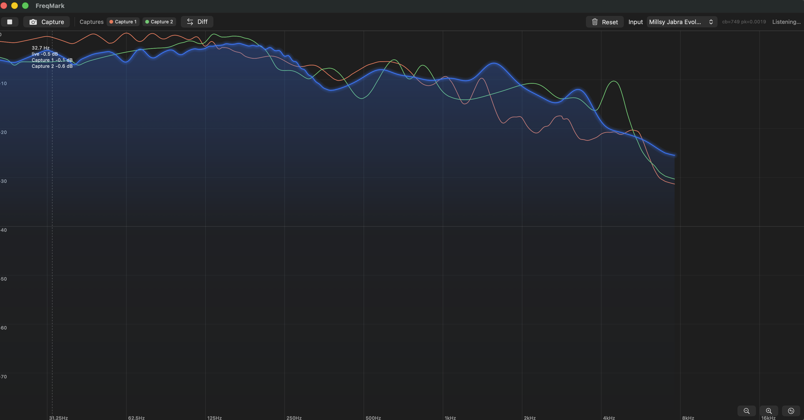

# FreqMark

FreqMark is a macOS app designed for comparing multiple audio signals — for example, comparing the frequency response of a clean guitar or bass to an affected guitar sound. It's built for hearing with your eyes: drop a pedal in front of your signal and see exactly what it does to your tone, frequency by frequency. Especially helpful for preparing your effects for real-world live applications — knowing what a fuzz, compressor, or envelope filter costs you in low end before you're on stage.



## Features

- **Live frequency response** — real-time spectrum of any chosen audio input on a logarithmic frequency axis (20 Hz → Nyquist), with a proper dB scale on the y-axis
- **Spectrum-analyzer ballistics** — instant attack, smooth decay, and heavy smoothing, so the trace is legible at a glance instead of flickering FFT noise
- **Frequency markers** — click anywhere on the plot to drop a named, colour-coded pin (handy for 40/80/160 Hz checks on bass); drag to reposition; hover to delete
- **Frozen captures** — snapshot the current response and stack it on the plot as a persistent coloured curve ("Clean", "Fuzz on", …)
- **Diff layers (Δ)** — pick two captures and FreqMark renders *B − A in dB* across the whole spectrum, so "how much low end did this pedal eat?" is one curve, one glance
- **Crosshair readout** — hover anywhere to get the exact frequency and dB level of the live trace, every visible capture, and every Δ layer at that point
- **Input device picker** — capture from any CoreAudio input (SSL 12, interface, headset) — AUHAL-based, so your interface shows up by name and the selection persists across launches
- **Zoom & pan** — magnify the range you're mixing in (the bass end of a log axis can use more room than the top octave)

## The bass-player workflow

1. **Reset** the workspace (trash icon).
2. Plug your bass into the interface's instrument input (e.g. SSL 12), pick it under **Input**, and play a consistent passage. Hit **Capture** — that's your clean baseline.
3. Click on the plot to drop markers at the frequencies you care about (a cleaner "low-mid definition" band, 160 Hz "fundamental thickness", etc.).
4. Engage your effect (fuzz / distortion / chorus / whatever), replay the *same* passage, hit **Capture** again.
5. Press **Diff**, then click the processed capture chip (A→B). The Δ curve shows precisely, in dB, which frequencies the effect boosts and which it swallows.
6. If the Δ layer is dipping hard in the 40–160 Hz region, that pedal will thin you out live — either EQ-compensate before it, or stack a low-end blend/parallel channel after it.

Repeat step 4–5 for every pedal in your chain; freeze each one and toggle captures on/off in the toolbar to A/B them all against the clean profile.

## How it works

- **Capture:** `AVAudioEngine`/AUHAL against a *selected* CoreAudio input device (not the system-default tap), mono downmix, native device sample rate
- **Analysis:** 2048-point FFT (vDSP `vDSP_fft_zip`), Hann window, 50 % overlap hops, resampled to a 512-point log-frequency grid
- **Post:** peak-relative dB conversion (−80 → 0 dB), rise-fast/fall-slow ballistics, two-stage smoothing with octave-weighted averaging
- **Rendering:** SwiftUI `Canvas`, layered live + captures + Δ, gradient fill and glow on the live trace
- **Persistence:** markers, captures and Δ layers are JSON in `~/Library/Application Support/FreqMark/`, surviving relaunches

## Building

```bash
brew install xcodegen
cd FreqMark
xcodegen generate           # regeneration needed after adding Swift files
xcodebuild -project FreqMark.xcodeproj -scheme FreqMark -configuration Debug build
open Build/Products/Debug/FreqMark.app   # or find it under DerivedData
```

Requirements: macOS 14+, Xcode with iOS 17+/macOS SDK, `xcodegen` via Homebrew, microphone permission granted on first launch.

## Tips & troubleshooting

- **No curve moving?** Give the app mic permission (System Settings → Privacy & Security → Microphone) and confirm the right input is selected. The toolbar shows a `cb=` counter — that increments only when real audio callbacks arrive. `cb` climbing but curve flat = the input's recording volume is at zero; `cb` stuck = dead stream (FreqMark auto-restarts those once via watchdog).
- **The curve only moves when there's signal** — play or play *something*; the FFT has nothing to say about silence.
- **Upper range looks like noise?** Headsets often run at 16 kHz sample rate (≈ 8 kHz Nyquist); interfaces normally run 48 kHz (≈ 22 kHz usable). Switch to the interface input for full-bandwidth measurement.
- **Comparing captures fairly:** keep playing technique/level consistent — the trace is *relative* to each frame's peak, so it shows shape, not absolute SPL.

## Status

v1, single-window macOS app (SwiftUI, no third-party dependencies). Built and maintained as a personal tool; PRs and issues welcome — see the repo at github.com/chilemams/FreqMark.

## License

MIT — see [LICENSE](LICENSE). FreqMark is free to use, modify and redistribute; attribution appreciated but not required. Audio hardware names mentioned in docs (SSL 12, Jabra) belong to their respective owners.
